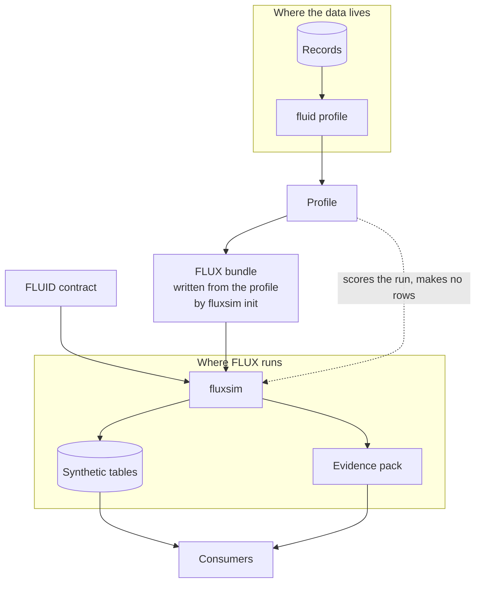
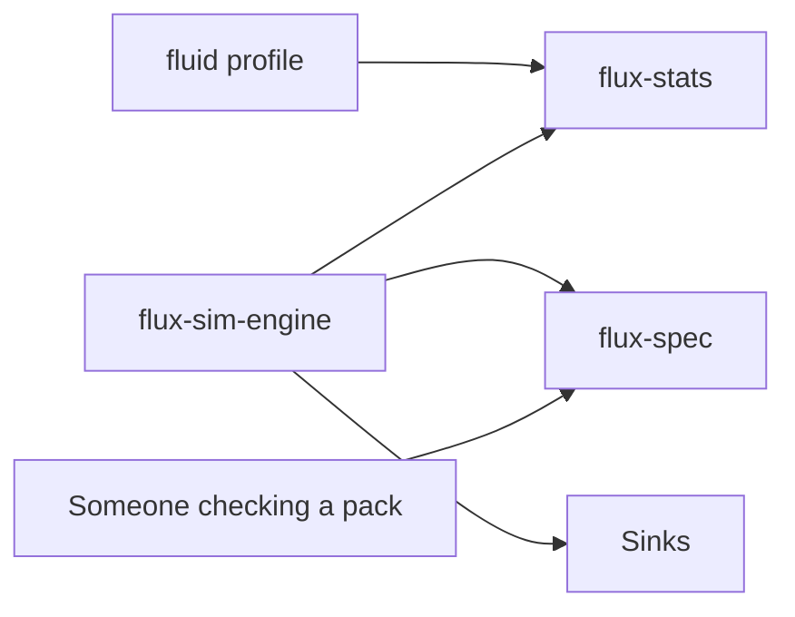
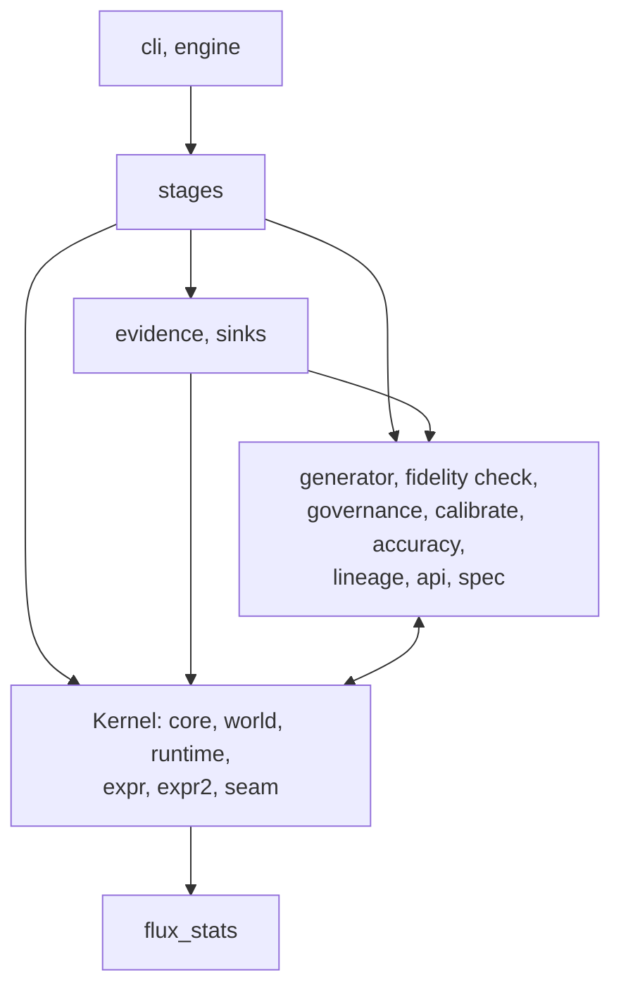
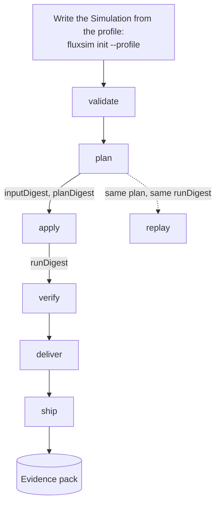

# Architecture and patterns

This page draws the engine one level at a time. It starts with the engine in its world, then zooms in to the parts you install, then to the packages inside the engine, the way the C4 model zooms from context to containers to components. After that it follows one run from start to finish, names the patterns the code is built on, and says how the project keeps them true. Each part links to the page or decision record that goes deeper.

## Words this page uses

- **FLUX**, Flow Language for Universe eXperimentation, is the specification for declared synthetic customer universes. **FLUID**, Federated Layered Unified Interchange Definition, is the specification for data products. The FLUX Simulation Engine runs the first against the second.
- A **FLUID contract** describes a data product: its tables, which FLUID calls *exposes*, with their columns, types and keys.
- A **FLUX bundle** is a directory of YAML documents that declare a synthetic world: a population, what it does, and what the business does about it.
- A **persona** is a kind of customer in that world: demographics, named traits and a worldview.
- A **Simulation** is the bundle document that ties it together: it names the world, its personas and their behaviour, and the contract its rows are for. Each table it writes is an *emit*.
- A **Playback** is the bundle document that calibrates a world. Today the engine reads only the scorecard its author declares in it.
- The **seam** is where a Simulation meets its contract.
- A **profile** is a JSON document of aggregate statistics about real data, such as counts, shares of nulls and histograms. It holds no records.
- A **digest** is a SHA-256 fingerprint of some bytes. Change one byte and the digest changes.
- The **kernel** is the six packages held to the determinism rules: `core`, `world`, `runtime`, `expr`, `expr2` and `seam`.
- An **in-toto statement** is a standard JSON form for a claim about files, here about the evidence pack.
- **RFC-04** is the FLUX specification's enforcement contract for AI calls. Given a model, a use case, a purpose and a number of tokens, it allows or denies the call and says why. The engine's **enforcement gate** is the one place that asks it, and the **RFC-04 vectors** are the specification's published test cases for it, which `verify` replays.

## What FLUX is, and what it is not

FLUX turns a declared scenario into synthetic tables that follow a FLUID contract. You write a bundle, point it at a contract, and the engine writes the rows, with an evidence pack that says what was checked and what was not. The same bundle and seed give the same rows and digests on every system the project's CI checks; [a few files](./determinism-and-the-seed-tree.md#what-legitimately-differs-between-runs) record the time and differ. The rows come from numbers the bundle declares. `fluxsim init --profile` writes those numbers from a profile's published aggregates, and the engine can score a run against a profile, but the engine draws rows only from the declared numbers and fits nothing to real records, so the rows carry only the relations someone declared. FLUX gives no privacy guarantee, and claims nothing about privacy, fairness or anything trained on its rows. The tables a Simulation generates from statistics for one FLUID 0.7.7 contract are generated together: keys come from the contract and never repeat, and every foreign key names a row its parent holds (section 8.2 of [the kernel specification](../spec/KERNEL-SPEC.md)). A child row's other columns are drawn on their own, so they do not follow from the parent row it names.

## What a run can generate

A run makes more than one flat table:

- **Several tables at once.** A Simulation writes one stream per emit, each with its own table's columns, order and types.
- **Columns drawn from declared statistics.** Strings, integers, decimals, booleans, dates and timestamps come from four families of distribution: categorical, bounded normal, rate, and uniform or histogram. A column can be [drawn given a categorical one](../how-to/draw-a-column-given-another.md), so the link between the two survives.
- **A world that moves through time.** A population of personas with traits sends signals, detectors and journeys move customers between states, campaigns reach them and experiments assign variants. Those events become the rows of a scenario emit.
- **Nested values.** A column the contract types as `struct`, `array`, `map` or `json` is accepted, and a value that fills it in a scenario emit is written as canonical JSON. The statistics generator does not draw nested values: in an emit it generates, such a column is refused (`FLX-3401`).
- **Related tables.** The keys a FLUID 0.7.7 contract declares are laid out from the row index, so none repeats, composite keys included. A foreign key takes its parent's key at a parent row: the one nearest the value its own declaration draws, a uniform pick, or, for one to one, a permutation that reaches each parent once. Nothing is held in memory, so `--jobs` gives the same bytes.

## The big picture

*Records stay where they live. Rows come from the contract and the bundle, and the profile only scores the run. `fluid profile` writes column metrics, a row count and, where its output checks allow, an ungrouped mean of each number column. A check on such a mean is scored; a check that reads any other statistic is refused (`FLX-5037`).*

The data owner keeps the records. `fluid profile`, a command in the `profile` extra of [forge-cli](https://github.com/Agenticstiger/forge-cli), reads one table of a contract where its records live and writes a profile. Before a number leaves, it applies disclosure rules whose defaults come from ACRO, an open-source tool that helps people check statistical outputs before release: a count under 10 is withheld, and counts are rounded to a multiple of 5. These are output-checking conventions, not a privacy guarantee ([ADR 0003](../adr/0003-sdv-bsl-and-aggregate-only-rule.md)).

Three documents cross over: the contract, the profile and the bundle. The engine does not draw rows from a profile. `fluxsim init --contract --profile` writes the Simulation's numbers from the profile's published aggregates, and its parameter register says what each number rests on: the profile, the contract, or an assumption with its reason. The numbers can also be written by hand. The engine draws the rows from those numbers and the contract, and uses the profile only to check and score the run. A Simulation that uses a profile pins it by its digest, and it can pin the contract the same way (it must, when the contract declares keys). `fluxsim` refuses a pinned document that has changed. Out come the synthetic tables, which consumers query as they would the real ones, and an evidence pack that anyone can check offline.

One path does not keep to this yet. A *fidelity check* compares statistics of the rows with the same statistics of real data, and a failing check stops the rows from shipping. It usually reads those statistics from a profile, but `--committed-slice`, on `run`, `verify` and `ship`, hands it a file of real records instead, and the engine reads that file. ADR 0003 names this as the one exception to its rule, and the reading is to move into the profiler.

## The parts you install

C4 calls a separately installed piece a *container*. FLUX has five.

| Part | What it owns | Who installs it |
|---|---|---|
| `flux-spec`, from [Agenticstiger/flux](https://github.com/Agenticstiger/flux) | The FLUX schemas, the FLUID schemas a contract may target, the document validator, the enforcement decision for AI calls, and the evidence bundler. | Everyone who installs the engine, which depends on it. Someone who only checks a pack can install it alone. |
| `flux-sim-engine`, this repository | The `fluxsim` command and its Python library. | Whoever generates the rows. |
| `flux-stats`, in `packages/flux-stats/` | One definition per statistic, the profile reader, the rules for reading a value from a record, and the mechanism of the `FLX` code catalog. It needs only the standard library. | Both sides. The engine pins its exact version, and the data owner installs it next to `fluid profile`. |
| `fluid profile`, in forge-cli | Reading records where they live, the disclosure rules, and writing the profile. | The data owner, next to the data. |
| Sinks | Where the rows land besides the run's own NDJSON files (one JSON value per line): Parquet or Arrow IPC files (the `arrow` extra), a database through ADBC, Arrow Database Connectivity (the `adbc` extra), or a plug-in. | Whoever generates, by choosing an extra or a plug-in. |

flux-stats is on PyPI from 0.6.0, released with the engine at the same version. `fluid profile` is in data-product-forge, forge-cli's package on PyPI, from 0.31.0, and its `profile` extra installs flux-stats from PyPI. It writes column metrics, a row count and an ungrouped `mean/1` for each number column, unless the output checks withhold it.

*Arrows are dependencies. `flux-stats` depends on nothing, so the data owner's side needs no engine.*

The statistics sit in a distribution of their own because both sides must compute them the same way: the profiler on the owner's side, the fidelity check on the engine's. Sharing the code is the simplest way to make sure a number means the same thing in both places ([ADR 0009](../adr/0009-flux-stats-distribution.md)).

## Inside the engine

This is the map of the engine's packages. Find the thing that does X here, then read its module's docstring.

| Package | What it owns |
|---|---|
| `flux_engine/cli/` | The `fluxsim` command: one module per command, plain text or `--json`. |
| `flux_engine/engine.py` | The async front door for a host process: one `async` function per step. |
| `flux_engine/stages/` | The steps of a run, and `pipeline.py`, the one execution core most of them share. |
| `flux_engine/generator/` | Rows drawn from a contract's column types and declared statistics. |
| `flux_engine/concordance/` | The fidelity check, the scorecard, the shape flags and sample-based checks. |
| `flux_engine/evidence/` | `EVIDENCE.md`, column provenance, the parameter register's record and the evidence pack. |
| `flux_engine/sinks/` | The output sinks and the registry that finds them. |
| `flux_engine/governance/` | The gate for AI calls, the audit of its decisions, and sovereignty checks. |
| `flux_engine/calibrate/` | Calibration from the scorecard a Playback declares. |
| `flux_engine/accuracy/` | Outcome accuracy: predictions registered before a run and scored after it. |
| `flux_engine/lineage/` | OpenLineage run events. |
| `flux_engine/api/` | Ports: Protocols and frozen dataclasses, with no logic, for third parties and in-process callers. |
| `flux_engine/spec/` | The shim over `flux-spec`: its validator, enforcement decision and bundler. |
| `flux_engine/verticals/`, `flux_engine/starter/` | Attribute packs for each industry, and the project `fluxsim init` writes. |
| `flux_engine/safeio.py` | Reads and writes under the state directory that never follow a link. |
| `flux_engine/describe.py`, `flux_engine/_links.py`, `flux_engine/_vocabulary.py` | What `fluxsim describe --self` reports, the addresses of these pages, and the words public text may not use. |
| `flux_engine/core/` | Kernel. Canonical bytes and digests, the seed tree, draws, the virtual clock, the trace, cohort splits. |
| `flux_engine/world/` | Kernel. The population: cohorts, markets and traits. |
| `flux_engine/runtime/` | Kernel. Signals, detectors, journeys, campaigns and experiments. |
| `flux_engine/expr/`, `flux_engine/expr2/` | Kernel. The two expression languages, `flux-expr/1` and `flux-expr/2`. Nothing in a run reads `flux-expr/2` yet. |
| `flux_engine/seam/` | Kernel. Resolving the contract and its keys, the emit stream, attestations and the profile pin. |

*Each arrow is a direction of import the code uses. None leaves the kernel for `cli`, `engine`, `evidence` or `sinks`, and none leaves `flux_stats`.*

The picture is not a strict stack. `cli` also calls a few packages directly for the commands outside the run, and the kernel uses the port types in `api`, the `spec` shim and one helper of the fidelity check, which is why that arrow has two heads. What the project enforces is narrower and stricter: seven contracts in `pyproject.toml` for import-linter, a tool that checks which module may import which. CI checks them on every pull request.

| Rule | Why |
|---|---|
| The kernel may not import `time`, `random`, `uuid`, `secrets`, `os` or `socket`. | A run depends on its inputs alone: no clock, no randomness, no made-up identities, no environment, no network. |
| The kernel may not import `cli`, `engine`, `evidence` or `sinks`. | Rows and digests never depend on how a run is shown, packed or delivered. |
| `evidence` may not import `runtime`. | The evidence pack is built from the files a run wrote, never from a live simulation. |
| Only `core.canonical` may import `rfc8785` and `hashlib`. | One canonical form, so a document has exactly one digest. |
| Only `governance.gate` may import `spec.enforce`. | One door to the enforcement decision. |
| Only the sinks may import `pyarrow` or the ADBC driver manager. | The core install stays small; the heavy columnar libraries are extras. |
| `flux_stats` may not import the engine, the six modules of the first rule, or `hashlib`. | The data owner can install the statistics alone. |

A module could dodge an import rule by importing a function instead of its module, so `tests/test_architecture.py` also scans the kernel and `flux_stats` for calls to the clock, `uuid` and `random`.

## The life of a run

*A labelled arrow names the digests the next step checks before it does anything.*

A run starts from a bundle. When its numbers come from real data, the data owner runs `fluid profile` (forge-cli's `profile` extra) where the data lives; it writes the profile and prints its digest. `fluxsim init --contract --profile` then writes a bundle whose numbers come from that profile, and whose Simulation pins its digest ([Write a bundle from a profile](../how-to/write-a-bundle-from-a-profile.md)); the numbers can also be written by hand. `plan` needs the pinned profile handed to it with `--profile`, `ship` needs it too, and `verify` needs it for the scorecard; a profile and a pin that do not pair are refused (`FLX-3109`). Every check the Simulation declares, and so its scorecard, reads statistics from the profile, and `fluid profile` writes one kind: an ungrouped `mean/1` for each number column, unless the output checks withhold it. A `mean` check over such a column is scored, and a run that passes ships. `verify --profile` refuses a check that reads another statistic, such as a support or a mean over a date column (`FLX-5037`), and `ship --profile` then withholds the run (`FLX-8001`). A mean the profile withheld is censored and left out of the score; when every declared check is censored, nothing is scored and `ship --profile` withholds the run as well. A bundle can also declare its numbers with no profile at all, as the starter project that `fluxsim init` writes does.

`fluxsim run` is `plan` then `apply`, followed by the steps you ask for (`--verify`, `--sink`, `--ship`) in this order. Delivery to a sink is not a command of its own: it is what `run --sink` does after `verify` and before `ship`, so a run that failed its checks lands nowhere.

| Step | Reads | Writes | Refuses when |
|---|---|---|---|
| `validate` | The bundle. | Nothing. | A document breaks the schema or the seam (`FLX-3105`), or the bundle holds a file it should not (`FLX-3108`). |
| `plan` | The bundle, and the profile it pins. | `plan.json`, with `inputDigest`, `seedTreeDigest`, the seam digests, the column provenance digest and `planDigest`; and `seed-paths.ndjson`. | Anything `validate` refuses, or a profile that is not the one pinned. |
| `apply` | `plan.json` and the bundle. | The population, events, decisions and lineage; one row stream and one seam attestation per emit; `column-provenance.json`; `run-digest.json`; and `receipt.json`, last. | The plan was edited (`FLX-2102`), the bundle moved (`FLX-2101`), or the run reaches a seed path the plan did not record (`FLX-2201`). |
| `verify` | The run directory, the bundle, and a profile or committed slice when given. | Nothing, unless you record a golden baseline. | The bundle moved (`FLX-2101`), the plan does not belong to the run (`FLX-2113`), or a record the plan holds a digest of has moved (`FLX-2115`, `FLX-2116`). |
| `deliver` | Each stream's lines, the exact bytes its digest covers. | Files or tables in the sink, and `sink-receipts.json`. | A sink or setting is unknown, checked before the run starts. |
| `ship` | The run directory and the bundle. | `EVIDENCE.md`, then the archive, its manifest and two in-toto statements. | An artifact no longer matches its digest (`FLX-2110`), or a fidelity check withholds (`FLX-8001`). Then nothing is packed. |
| `replay` | `plan.json` and the bundle. | The same run directory again. | The run digest it reaches is not the one you assert (`FLX-2106`). |

[The six-step loop](./the-six-step-loop.md) walks through each step with its commands and files, and the [error codes](../reference/errors/README.md) say what each code means.

The run id is the first 16 hex digits of `planDigest`, so planning the same bundle twice lands in the same directory. No step writes or reads a run's files through a link: a directory the engine writes under that is a link is refused (`FLX-2118`), and so is a link at the name of a file it appends to or reads back (`FLX-2117`). `--jobs N` lets `plan`, `apply` and `run` make the rows of an emit declared by statistics in several processes. Each value is addressed by its row and its column, so a slice of rows is the same in any process; the slices are joined in row order, and the bytes and every digest are those one process gives.

`verify` re-checks a finished run without running it again, on five independent legs: the artifacts against their digests, the golden baseline, row conformance, the enforcement vectors, and each declared fidelity check.

With `--profile`, `verify` also scores the run against the profile. The *scorecard* holds exact scores per property, table, dimension and run, and the *shape flags* point out where the rows look unlikely under the profile, such as a histogram bin the profile fills and the run leaves empty. The flags inform; they gate nothing.

With `--sample`, `verify` compares each emit's means with the profile on a sample of whole blocks of records, each decided by its 95 per cent interval, so a large run is checked quickly. A sampled `verify` forms no scorecard, and `ship` still reads every record.

`ship` checks again rather than trust that `verify` ran. Its fidelity gate either passes every declared check or packs nothing.

## Patterns

Where a pattern is borrowed, a docstring or a decision record names the source. Each entry gives the problem, the answer, where it lives, what it costs, and where to read more.

### The aggregate-only boundary

- **Problem.** A generator fitted to real records is derived from them, and can repeat them.
- **Solution.** The engine never reads a record of the data it imitates; one path, the committed slice, is still the exception. A profiler reads records where they live and lets out only aggregates, after disclosure rules. The rows come from declared numbers.
- **Where.** `flux_engine/generator/`, `flux_engine/seam/profile.py`, `packages/flux-stats/src/flux_stats/profile.py`.
- **Trade-off.** The rows hold only what the numbers say. A relation nobody declared is not in them.
- **Read more.** [ADR 0003](../adr/0003-sdv-bsl-and-aggregate-only-rule.md), [the profile specification](../spec/PROFILE-SPEC.md).

### Content addressing and plan binding

- **Problem.** The plan you reviewed and the run you got can drift apart, and so can a contract and the rows written for it.
- **Solution.** Inputs and outputs are named by digests. `plan` records a digest of the bundle's files and one of the plan itself, and `apply` refuses a plan or a bundle that moved. It is Terraform's plan and apply, held together by digests. The run digest folds in a digest of each part of the run, so a failure names the part that moved.
- **Where.** `flux_engine/stages/plan.py`, `flux_engine/stages/apply.py`, `flux_engine/stages/layout.py`, `flux_engine/core/trace.py`.
- **Trade-off.** The plan hashes the raw bytes of every bundle file, the contract included, so even a comment means a new plan and a new run id. The pins a Simulation holds are different: they are taken over the parsed contract and profile, so reformatting either one keeps its pin.
- **Read more.** [ADR 0006](../adr/0006-input-digest-is-a-closed-set.md), [the six-step loop](./the-six-step-loop.md).

### Determinism by construction

- **Problem.** A run that depends on call order, the clock or the platform cannot be repeated, so it cannot be checked.
- **Solution.** Every random value comes from a stream addressed by a path, under a root made from the seed and `H`, the digest of where the Simulation meets its contract. Each draw uses a fixed number of random words, with no retry loops. Time is whole milliseconds on a virtual clock, and one thread runs events in the order of a unique key. Bytes are canonical: RFC 8785 JSON, every string in one Unicode normal form (NFC), no floats.
- **Where.** `flux_engine/core/seedtree.py`, `flux_engine/core/rng.py`, `flux_engine/core/clock.py`, `flux_engine/core/canonical.py`, `flux_engine/stages/_parallel.py`.
- **Trade-off.** Speed. A bounded integer always draws all 64 of its words, and numpy is used only as a source of raw words, never for its distributions.
- **Read more.** [Determinism and the seed tree](./determinism-and-the-seed-tree.md), [the kernel specification](../spec/KERNEL-SPEC.md).

### A deterministic kernel, effects at the edges

- **Problem.** A clock read, an environment variable or a random id deep in the code would make runs differ, and a reviewer would not see it.
- **Solution.** The functional core and imperative shell pattern, enforced by import rules. The kernel reads the inputs it is handed. When it writes a file, it takes the writing function as an argument, and the stages pass one that never follows a link; it never writes into the bundle (`FLX-3106`). Choosing directories, starting worker processes, signing, stamping a lineage event with the time, packing and delivering all happen outside it.
- **Where.** `pyproject.toml`, `tests/test_architecture.py`, `flux_engine/stages/pipeline.py`, `flux_engine/safeio.py`.
- **Trade-off.** Everything the kernel needs has to be passed in, and the files that carry the clock (a lineage event, the date on `EVIDENCE.md`) differ between two runs that are otherwise identical.
- **Read more.** [ADR 0001](../adr/0001-diverge-from-mesa.md), [the kernel specification](../spec/KERNEL-SPEC.md).

### Ports and adapters

- **Problem.** Where the rows land changes from one user to the next, and must never change what a run is answerable for.
- **Solution.** `flux_engine/api/` holds the ports, such as `EmitSink`. A sink is an adapter. The built-in ones are names in a table, imported only when chosen, and a third party registers one under the `flux_engine.sinks` entry point group. The digest is computed before any sink sees a row, and every delivery leaves a receipt.
- **Where.** `flux_engine/api/emit.py`, `flux_engine/sinks/registry.py`, `flux_engine/stages/deliver.py`.
- **Trade-off.** A built-in name always wins over a plug-in that reuses it. Some ports wait for adapters the engine does not ship: the agentic tier's model port proposes and never decides ([ADR 0004](../adr/0004-concordia-tinytroupe-adapt-the-pattern.md)), and the proof port has only a no-op.
- **Read more.** [Load a simulation into a database](../how-to/load-a-simulation-into-a-database.md).

### One error catalog, typed refusals

- **Problem.** A failure that only says "error" sends you into the source, and a script cannot tell one failure from another.
- **Solution.** A catalogued failure carries an `FLX-nnnn` code, in a band that names its area: 1000 canonical bytes, 2000 plan binding, 3000 the seam, 4000 governance, 5000 numerics, 6000 expressions, 7000 calibration, 8000 the evidence pack. The module that raises a code registers it with a title and an explanation, so no central list can drift from the code. `fluxsim explain` prints the entry, the reference pages are generated from the catalog, and each step has its own exception class.
- **Where.** `packages/flux-stats/src/flux_stats/errors.py`, `flux_engine/core/errors.py`, `flux_engine/api/stages.py`, `scripts/gen_docs.py`.
- **Trade-off.** Every new refusal is a new public code with its own page. When in doubt the engine refuses, so you meet a code where a looser tool would have guessed.
- **Read more.** [Error codes](../reference/errors/README.md).

### Evidence first

- **Problem.** A synthetic dataset invites claims nobody checked, such as "this behaves like our customers".
- **Solution.** `ship` packs a run with its evidence. `EVIDENCE.md` has six fixed sections, and the last, "What Was Not Proven", comes from a fixed template and is always there. Column provenance says how each column was made. The parameter register says what each number rests on: a statistic of the profile, an assumption with its reason, or a default. `verify` keeps two verdicts, `reproducible` and `validity`, and never folds them into one.
- **Where.** `flux_engine/evidence/report.py`, `flux_engine/evidence/provenance.py`, `flux_engine/evidence/register.py`, `flux_engine/evidence/pack.py`, `flux_engine/api/verdict.py`.
- **Trade-off.** The claims stay narrow on purpose. `validity` reads `not asserted` in this release, the in-toto statements are unsigned, and a fidelity record signed without `--signing-key` is attributable to nobody.
- **Read more.** [The evidence pack](./the-evidence-pack.md), [the parameter register specification](../spec/PARAMETER-REGISTER-SPEC.md).

### Exact arithmetic

- **Problem.** Floating point can give different last digits on different platforms, and a digest sees every digit.
- **Solution.** No float reaches anything that is hashed (`FLX-1001`), and a `float` or `double` column is refused by name (`FLX-3001`). Values are decimals and fractions. Cohorts are split by the largest-remainder method on exact fractions. The inverse normal is computed in Python's `decimal` at 28 digits. Statistics sit on an integer grid that rounds toward minus infinity. A binomial tail is decided exactly: two bounds settle it when they can, and the exact fraction is formed only when they cannot. A sampling interval is rounded outward, so it errs wide.
- **Where.** `flux_engine/core/lrm.py`, `flux_engine/core/rng.py`, `packages/flux-stats/src/flux_stats/fixedpoint.py`, `packages/flux-stats/src/flux_stats/tails.py`, `packages/flux-stats/src/flux_stats/sampling.py`.
- **Trade-off.** Exact numbers are slower, and they can grow without limit, so the readers cap them: a number that needs more than 1000 digits written out is refused (`FLX-5005`).
- **Read more.** [The kernel specification](../spec/KERNEL-SPEC.md), [the scorecard specification](../spec/SCORECARD-SPEC.md).

### Contract first

- **Problem.** If a Simulation restated its contract's columns or keys, the two copies could disagree, and nobody would know which one the rows follow.
- **Solution.** A Simulation names its contract and never restates it. Columns, types and keys come from the contract. From FLUID 0.7.7 its relationships and entities give the primary and foreign keys, and a Simulation that restates a key is refused (`FLX-3111`). The rules about valid data are to come from the contract too, written in FLUID SQL/1, which `flux-expr/2` implements.
- **Where.** `flux_engine/seam/resolve.py`, `flux_engine/seam/contract.py`, `flux_engine/seam/keys.py`, `flux_engine/expr2/`.
- **Trade-off.** FLUX can use only what FLUID can declare. A contract that declares keys cannot yet carry a YAML float or text that is not in NFC. Related tables are generated together only when every table a relationship names is generated from statistics in the same Simulation.
- **Read more.** [The FLUID seam](./the-seam.md), [ADR 0008](../adr/0008-flux-expr-2-derived-columns-and-rules.md).

### A separate statistics distribution

- **Problem.** The data owner needs the same statistics as the fidelity check, without installing a simulation engine next to the data.
- **Solution.** `flux-stats` holds one definition per statistic, the profile reader and the record-reading rules, with no third-party dependency. The engine pins its exact version, and one tag releases both. An import rule keeps the engine out of it.
- **Where.** `packages/flux-stats/`, `packages/flux-stats/src/flux_stats/registry.py`, `packages/flux-stats/src/flux_stats/reading.py`.
- **Trade-off.** Two distributions to release in step, and an exact pin. Each Python normalises text with its own Unicode tables, so a character newer than one of two Pythons can be read differently by each, a risk ADR 0009 records.
- **Read more.** [ADR 0009](../adr/0009-flux-stats-distribution.md).

### Depend on the specification, never copy it

- **Problem.** Two copies of a schema or a validator drift apart, and then the engine and the published tool give different answers.
- **Solution.** The engine takes the validator, the enforcement decision, the bundler and the schemas from the `flux-spec` distribution. The first three come through one shim, which refuses a version outside the range the engine supports. The copy of them the engine once carried was removed.
- **Where.** `flux_engine/spec/__init__.py`, `flux_engine/seam/resolve.py`.
- **Trade-off.** No engine runs without `flux-spec`, and a new FLUID version reaches the engine through a `flux-spec` release, not through an edit here.
- **Read more.** [ADR 0005](../adr/0005-depend-on-flux-spec.md).

### Closed sets, refused by name

- **Problem.** An open extension point is a place where behaviour can change without a new version.
- **Solution.** The engine works from closed lists and refuses anything outside them by name: the grammar of `flux-expr/1`, the column types, the operations a trace records, the files a bundle may hold, the industry packs. Growth comes as a new version, such as `flux-expr/2`, not as a quiet extension.
- **Where.** `flux_engine/expr/parser.py`, `flux_engine/seam/contract.py`, `flux_engine/core/trace.py`, `flux_engine/verticals/__init__.py`.
- **Trade-off.** You meet a refusal where a looser tool would accept, and a new idea waits for a version.
- **Read more.** [ADR 0002](../adr/0002-flux-expr-diverges-from-cel.md), [ADR 0006](../adr/0006-input-digest-is-a-closed-set.md).

## How quality is kept

- **Golden digests.** The plans, run digests and component digests of three reference bundles are stored under `tests/golden/` and compared on every test cell in CI. A stored file may change only with a row in `GOLDEN-CHANGELOG.md` that says why.
- **Conformance vectors.** Vector files under `tests/vectors/` pin canonical bytes, seed streams, cohort splits, both expression languages, how a row becomes a line of output, and the fidelity check. The FLUID SQL/1 vectors are forge-cli's, copied unchanged, and DuckDB serves as an oracle for the parts of SQL that `flux-expr/2` takes over.
- **Import rules.** `lint-imports` checks the seven contracts above, and `tests/test_architecture.py` scans the calls as well.
- **Help snapshots.** `tests/cli/help-snapshots/` records every flag, default and help text of `fluxsim`, for each Python version CI runs. A change to the command surface fails until the snapshots are rewritten and reviewed with it.
- **Pages that run.** Every command and file on these pages runs as a test (`tests/docs/`), the generated reference pages must match the code, and every link and named path must resolve.
- **Accuracy and determinism.** Every pull request runs the digest tests on Ubuntu under Python 3.11, 3.12 and 3.13 and on macOS under 3.12; the weekly run and each release tag run all six combinations. The [accuracy program](../accuracy/DESIGN.md) measures whether the samplers draw from the distributions they declare and whether the fidelity check accepts and withholds when it should; PractRand tests streams that sit side by side in the seed tree, and mutation testing runs weekly on the kernel's numerics.
- **End to end on AWS.** `e2e/aws/` plays both sides with a TPC-DS-shaped source on S3, Glue and Athena. The generator side gets only the contract, the profile and the script that writes the Simulation from them, and runs under `env -i` and, on macOS, a sandbox that refuses the network and the owner's files. Judges compare the two copies: FLUX's own `verify`, consumer queries run on both, key integrity, and optionally SDMetrics. The harness runs by hand against a sandbox account, not in CI; [its README](https://github.com/Agenticstiger/flux-engine/blob/main/e2e/aws/README.md) says how.
- **The privacy judge.** An optional judge of the same harness runs Anonymeter's singling-out, linkability and inference attacks, with people held out of the profile as the control. The source is TPC-DS-shaped and holds no real people, so it measures the method, not a customer base, and it is not a privacy guarantee.

## Read next

- [The six-step loop](./the-six-step-loop.md): each step with its commands and files.
- [Determinism and the seed tree](./determinism-and-the-seed-tree.md), [the FLUID seam](./the-seam.md) and [the evidence pack](./the-evidence-pack.md).

The specifications:

- [KERNEL-SPEC](../spec/KERNEL-SPEC.md): the kernel's rules, from canonical bytes and the seed tree to the emit stream and the run digest.
- [SEAM-FIDELITY-SPEC](../spec/SEAM-FIDELITY-SPEC.md): the generator that draws rows from a contract's columns, and the fidelity check.
- [PROFILE-SPEC](../spec/PROFILE-SPEC.md): the profile document and how a Simulation pins it.
- [SCORECARD-SPEC](../spec/SCORECARD-SPEC.md): a run's scores against its profile, and the shape flags.
- [SAMPLE-SPEC](../spec/SAMPLE-SPEC.md): `verify --sample`, means checked on a sample of whole blocks.
- [PARAMETER-REGISTER-SPEC](../spec/PARAMETER-REGISTER-SPEC.md): what each number a run reads rests on.
- [EXPR-SPEC](../spec/EXPR-SPEC.md): `flux-expr/1`, the closed expression language a bundle's predicates are written in, such as a segment's.
- [EXPR-SPEC-2](../spec/EXPR-SPEC-2.md): `flux-expr/2`, FLUID SQL/1 and FLUX's extensions, for rules about valid data.

The decision records:

- [ADR 0001](../adr/0001-diverge-from-mesa.md): the engine writes its own scheduler, clock and seed tree instead of depending on Mesa.
- [ADR 0002](../adr/0002-flux-expr-diverges-from-cel.md): `flux-expr/1` is a small closed grammar of its own, not CEL.
- [ADR 0003](../adr/0003-sdv-bsl-and-aggregate-only-rule.md): aggregates only; the engine never reads a record of the data it imitates, except through `--committed-slice`, which is to move into the profiler; and the profiler's disclosure defaults.
- [ADR 0004](../adr/0004-concordia-tinytroupe-adapt-the-pattern.md): the agentic tier adapts Concordia's and TinyTroupe's patterns and depends on neither.
- [ADR 0005](../adr/0005-depend-on-flux-spec.md): the engine depends on `flux-spec`, and its vendored copy is retired.
- [ADR 0006](../adr/0006-input-digest-is-a-closed-set.md): `inputDigest` covers a closed set of files, and the loader refuses anything else.
- [ADR 0008](../adr/0008-flux-expr-2-derived-columns-and-rules.md): `flux-expr/2` implements FLUID SQL/1 and adds FLUX's extensions.
- [ADR 0009](../adr/0009-flux-stats-distribution.md): the statistics are a distribution of their own, `flux-stats`.
